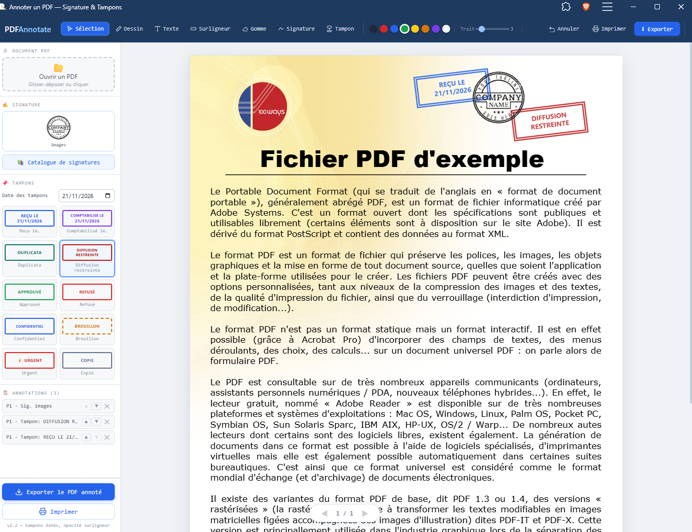

# 📝 PDFlys

> Un outil simple pour annoter des fichiers PDF : dessin, texte, surligneur, signatures et tampons, directement dans le navigateur.

Ouvrez un PDF, annotez-le, signez-le, tamponnez-le, puis exportez ou imprimez. Aucun serveur applicatif, aucune installation : de simples fichiers statiques. 🎯



---

## ✨ Fonctionnalités

- 📂 **Ouverture facile** : glisser-déposer, bouton « Ouvrir un PDF », lien direct (`?pdf=…`) ou « Ouvrir avec » depuis l'Explorateur Windows
- ✏️ **Dessin à main levée** avec 8 couleurs et une épaisseur de trait réglable
- 🔤 **Zones de texte** sur plusieurs lignes (`Maj + Entrée`) : police et taille modifiables après coup
- 🖍️ **Surligneur** à opacité réglable
- 🧽 **Gomme** pour effacer une annotation
- 🖱️ **Sélection** : déplacer, redimensionner ou supprimer chaque annotation
- ✍️ **Catalogue de signatures** : dessinées à la souris, au stylet ou au doigt, ou importées depuis une image avec retrait automatique du fond
- 🔖 **Tampons datés** : Reçu le, Comptabilisé le, Approuvé, Refusé, Urgent, Confidentiel, Brouillon, Copie, Duplicata, Diffusion restreinte
- 📋 **Liste des annotations** du document dans le panneau latéral
- ⬇️ **Export** en `<nom-du-fichier>-annoté.pdf` : les annotations sont **ajoutées en surcouche** au PDF d'origine, qui reste intact (texte sélectionnable, poids léger)
- 🖨️ **Impression** du PDF annoté au format réel des pages (et non de l'interface)
- 📱 **Installable en application (PWA)**
- 🔒 **100 % local** : le PDF ne quitte jamais le poste de l'utilisateur

---

## ⌨️ Raccourcis clavier

| Touche              | Action                        |
|---------------------|-------------------------------|
| `V`                 | Sélection                     |
| `D`                 | Dessin                        |
| `T`                 | Texte                         |
| `H`                 | Surligneur                    |
| `E`                 | Gomme                         |
| `S`                 | Signature                     |
| `P`                 | Tampon                        |
| `Suppr` / `Retour`  | Supprimer la sélection        |
| `Échap`             | Désélectionner                |
| `Entrée`            | Valider un texte en cours de saisie |
| `Maj + Entrée`      | Nouvelle ligne dans un texte  |
| `Ctrl + Z`          | Annuler                       |
| `Ctrl + P`          | Imprimer le PDF annoté        |

---

## 🚀 Déploiement

PDFlys est **100 % statique** : HTML, CSS et modules JavaScript, sans build, sans dépendance à installer et sans langage serveur.

> ⚠️ Les chemins sont absolus : l'outil doit être servi sous **`/outils/pdf-annotator/`**.
> Ouvrir `index.html` par double-clic ne fonctionne pas, car les modules ES exigent un serveur HTTP.

### Sur IIS (recommandé)

1. Copiez le contenu du dépôt dans un dossier servi à l'URL `/outils/pdf-annotator/` (par exemple `C:\inetpub\wwwroot\outils\pdf-annotator\`)
2. C'est tout : le `web.config` fourni se charge du reste
   - déclare les types MIME `.mjs` et `.webmanifest`
   - désactive le cache pour qu'une mise à jour soit visible tout de suite, sans `Ctrl + F5`

### Sur un autre serveur web

N'importe quel serveur statique convient (Apache, Nginx…). Il doit :

- servir le dossier à l'URL `/outils/pdf-annotator/`
- renvoyer les fichiers `.mjs` en `text/javascript`
- renvoyer `manifest.webmanifest` en `application/manifest+json`

### Ouvrir un PDF par lien

```
https://votre-serveur/outils/pdf-annotator/?pdf=/chemin/vers/document.pdf
```

Les paramètres `pdf`, `url` et `src` sont acceptés.

### Installer en application

Depuis Chrome ou Edge, cliquez sur l'icône d'installation dans la barre d'adresse. Une fois installé, PDFlys apparaît dans le menu **« Ouvrir avec »** des fichiers PDF sous Windows. 🪟

---

## 🧭 Utilisation

1. **Ouvrez** un PDF
2. **Choisissez un outil** dans la barre du haut (l'outil Sélection est actif à l'ouverture), puis une couleur et une épaisseur
3. **Annotez** la page directement
4. **Signez** : créez une signature une fois, elle reste disponible dans le catalogue
5. **Tamponnez** : choisissez la date, puis le tampon, et cliquez sur la page
6. **Exportez** ⬇️ ou **imprimez** 🖨️

---

## 💡 Bon à savoir

- **Export en surcouche** : le PDF d'origine est conservé tel quel (texte, polices, liens, formulaires) et les annotations sont ajoutées par-dessus, en vectoriel : traits et surligneur en tracés, textes et tampons en vrai texte (polices standard PDF : Helvetica, Times, Courier, non embarquées), signatures en images. Le fichier reste léger et son texte reste sélectionnable et indexable.
- **Caractères spéciaux** : une annotation que les polices standard ne savent pas écrire (emoji, ⚡ du tampon « Urgent »…) est ajoutée en image PNG à 300 ppp, à sa place exacte.
- **Polices** : à l'export, « Sans-serif » et « Arial » deviennent Helvetica, « Serif » Times, « Mono » Courier ; la largeur du texte peut varier légèrement par rapport à l'écran.
- **PDF protégé ou endommagé** : s'il ne peut pas être complété tel quel (PDF chiffré, même sans mot de passe d'ouverture), l'outil le signale et revient à l'**export aplati** : chaque page devient une image (JPEG haute qualité), le texte n'est alors plus sélectionnable.
- **Impression** : chaque page est recomposée à 200 ppp, au format réel du document.
- **Signatures** : elles sont enregistrées dans le navigateur (`localStorage`), sur le poste de l'utilisateur. Elles ne sont ni envoyées ni partagées, et une signature créée ne peut plus être modifiée, seulement supprimée.
- **Version** : le numéro de version s'affiche sous le bouton d'export et au survol du logo.

---

## 🗂️ Structure du projet

```
PDFlys/
├── index.html              # Interface
├── pdf-annotator.css       # Styles
├── manifest.webmanifest    # Manifeste PWA (installation, « Ouvrir avec »)
├── web.config              # Configuration IIS (types MIME, cache)
├── icons/                  # Favicon et icônes de l'application
├── modules/
│   ├── main.js             # Outils d'annotation, export, impression
│   └── signatures.js       # Catalogue de signatures
└── vendor/                 # Bibliothèques embarquées (aucun CDN)
    ├── pdfjs/              # Affichage des PDF
    └── pdflib/             # Génération du PDF exporté
```

---

## 🛠️ Technologies

- **JavaScript natif** en modules ES, sans framework ni build
- [PDF.js](https://mozilla.github.io/pdf.js/) **4.10.38** pour le rendu des PDF
- [pdf-lib](https://pdf-lib.js.org/) **1.17.1** pour la génération du PDF exporté (licence MIT)
- Aucune ressource externe : tout est embarqué dans `vendor/`

---

## 📄 Licence

<!-- Choisissez une licence et ajoutez un fichier LICENSE à la racine -->
À définir.

Les bibliothèques embarquées dans `vendor/` gardent leur propre licence.

---

<p align="center">Fait avec ☕ et 🖍️ par <a href="https://github.com/LysOffice">LysOffice</a></p>
